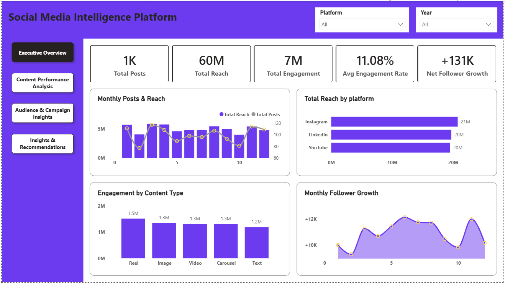
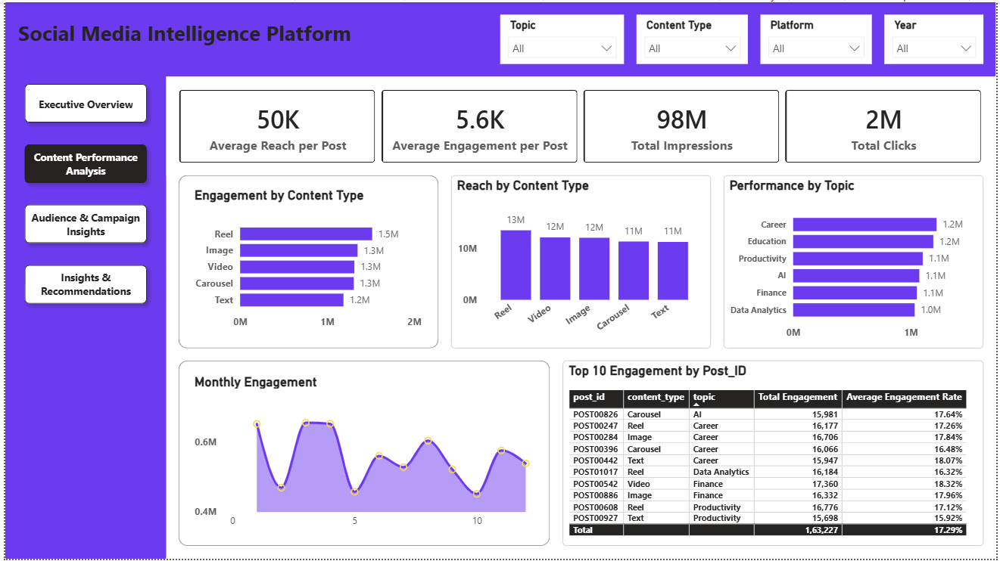
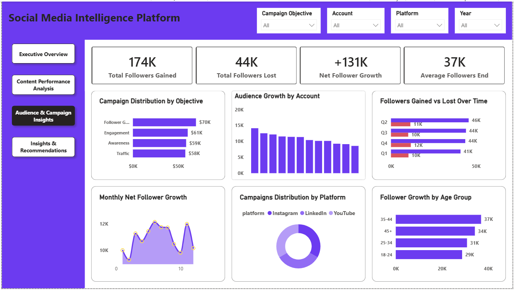
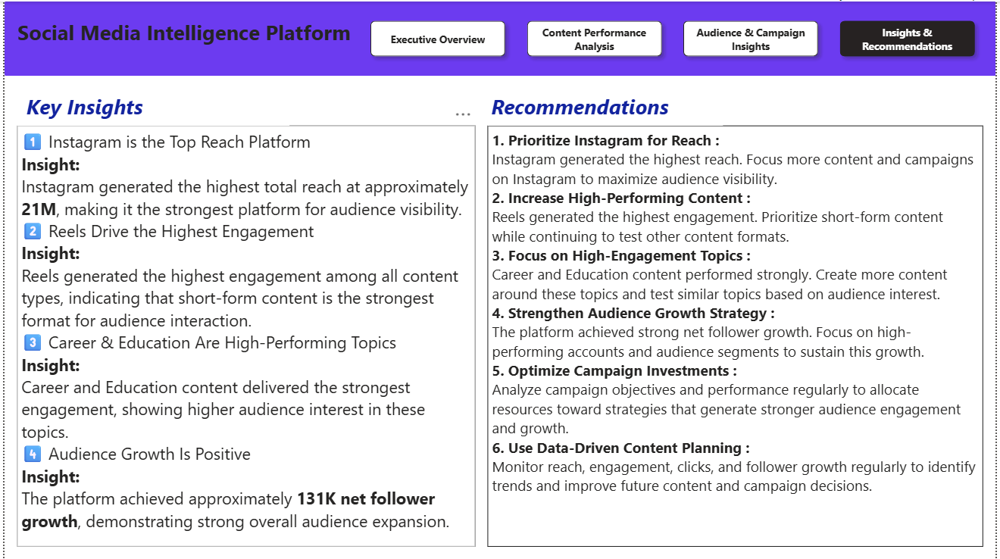

# 📱 Social Media Intelligence Platform

### End-to-End Data Analytics & Business Intelligence Project

An end-to-end Data Analytics project that analyzes social media performance across multiple platforms, accounts, content types, topics, audiences, and campaigns.

This project follows a complete analytics workflow using **Python for data preparation, SQLite for data storage and analysis, Power BI for data modeling and dashboard reporting, and Claude MCP for AI-assisted Power BI model development**.

---

# 📌 Project Overview

Social media teams generate large amounts of data related to content performance, audience growth, and marketing campaigns. However, analyzing these metrics separately can make it difficult to understand overall performance and identify opportunities for improvement.

The **Social Media Intelligence Platform** transforms raw social media datasets into an interactive business intelligence solution.

The project helps analyze:

- Content performance
- Reach and engagement
- Audience growth
- Campaign performance
- Platform performance
- Content topics and formats
- Audience demographics

The final solution provides a **four-page interactive Power BI dashboard** along with business insights and strategic recommendations.

---

# 🎯 Business Problem

A social media organization wants to understand how its content, accounts, platforms, and campaigns are performing.

The business needs a centralized analytics solution to answer questions such as:

- Which platforms generate the highest reach?
- Which content types drive the most engagement?
- Which topics perform better?
- How is the audience growing over time?
- Which accounts show stronger audience growth?
- How are campaigns distributed across objectives and platforms?
- Which audience age groups contribute most to follower growth?

### Main Business Question

> **How can social media performance data be used to identify content, audience, and campaign patterns that support better business and marketing decisions?**

---

# 🛠️ Technology Stack

| Technology | Purpose |
|---|---|
| Python | Data preparation and analysis |
| Pandas | Data manipulation and transformation |
| NumPy | Data analysis support |
| SQLite | Data storage and SQL analysis |
| SQL | Querying and validating business data |
| Power BI | Data modeling and interactive dashboard development |
| DAX | KPI and business calculations |
| Claude MCP | AI-assisted Power BI semantic model development |
| GitHub | Project documentation and portfolio delivery |

---

# 🔄 Project Workflow

```text
Raw Datasets
      ↓
Python Data Preparation & Validation
      ↓
Cleaned Datasets
      ↓
SQLite Database
      ↓
SQL Analysis
      ↓
Power BI Data Modeling
      ↓
DAX Measures
      ↓
Interactive Dashboard
      ↓
Insights & Recommendations
```

---

# 📊 Dataset Summary

The project uses four datasets covering social media accounts, campaigns, content performance, and audience growth.

| Dataset | Purpose |
|---|---|
| Accounts | Account, platform, category, and starting follower information |
| Campaigns | Campaign details, objectives, dates, and budgets |
| Content Performance | Post-level reach, engagement, impressions, clicks, and content details |
| Audience Growth | Follower growth and audience demographic information |

### Data Model Summary

| Table | Role |
|---|---|
| Dim_accounts | Account dimension |
| Dim_campaigns | Campaign dimension |
| Dim_Date | Central date dimension |
| Fact_content_performance | Post-level performance fact table |
| Fact_audience_growth | Audience growth fact table |

The project follows a **dimension and fact table model** to support scalable Power BI reporting.

---

# 🐍 Data Preparation Using Python

The raw datasets were loaded and reviewed using Python in a Jupyter Notebook.

### Activities Performed

- Loaded multiple social media datasets
- Reviewed dataset structure and columns
- Checked data types
- Performed data quality validation
- Prepared datasets for analysis
- Created cleaned datasets for reporting
- Saved processed data for database and Power BI usage

### Python Libraries Used

```python
import pandas as pd
import numpy as np
```

The complete data preparation workflow is available in:

```text
Social Media Analysis.ipynb
```

---

# 🗄️ SQLite Database

The cleaned datasets were stored in a SQLite database for structured data analysis.

### Database File

```text
social_media.db
```

SQLite was used to:

- Store project datasets
- Query the data using SQL
- Validate data structure
- Support the end-to-end analytics workflow

---

# 📊 Power BI Data Modeling

The project uses a structured Power BI data model with dimension and fact tables.

### Key Relationships

- Content performance → Accounts
- Audience growth → Accounts
- Content performance → Campaigns
- Content performance → Date
- Audience growth → Date

The model uses **many-to-one relationships with single-direction filtering from dimensions to fact tables**.

A dedicated **Dim_Date table** was created and configured for time-based analysis.

---

# 📈 Power BI Dashboard

The final Power BI dashboard contains **four interactive pages** designed to provide a complete view of social media performance.

---

## 📊 Page 1 — Executive Overview

Provides a high-level view of overall social media performance.

### Key KPIs

- Total Posts
- Total Reach
- Total Engagement
- Average Engagement Rate
- Net Follower Growth

### Analysis Areas

- Monthly Posts & Reach
- Total Reach by Platform
- Engagement by Content Type
- Monthly Follower Growth



---

## 📈 Page 2 — Content Performance Analysis

Provides a deeper analysis of content performance across different formats and topics.

### Key KPIs

- Average Reach per Post
- Average Engagement per Post
- Total Impressions
- Total Clicks

### Analysis Areas

- Engagement by Content Type
- Reach by Content Type
- Performance by Topic
- Monthly Engagement
- Top 10 Posts by Engagement



---

## 👥 Page 3 — Audience & Campaign Insights

Focuses on audience growth and campaign performance.

### Key KPIs

- Total Followers Gained
- Total Followers Lost
- Net Follower Growth
- Average Followers End

### Analysis Areas

- Campaign Distribution by Objective
- Audience Growth by Account
- Followers Gained vs Lost
- Monthly Net Follower Growth
- Campaign Distribution by Platform
- Follower Growth by Age Group



---

## 💡 Page 4 — Insights & Recommendations

This page summarizes the key findings from the dashboard and provides strategic recommendations.

### Focus Areas

- Overall performance insights
- Content performance patterns
- Audience growth trends
- Campaign observations
- Strategic recommendations for future improvement



---

# 📈 Key Business Insights

The dashboard provides several insights into social media performance, including:

- Social media performance can be compared across multiple platforms using reach and engagement metrics.
- Different content formats show different levels of audience engagement.
- Content topics can be analyzed to identify stronger-performing themes.
- Audience growth can be tracked across different accounts and time periods.
- Campaign objectives and platform distribution provide visibility into marketing activity.
- Audience age groups can be analyzed to understand follower growth patterns.

> **Note:** The insights represent patterns found in the available project data and should be interpreted as analytical observations rather than proof of direct cause-and-effect relationships.

---

# 💼 Business Recommendations

### 1. Focus on High-Performing Content

Identify content formats and topics that consistently generate strong engagement and use those insights to guide future content planning.

### 2. Optimize Platform Strategy

Compare reach and engagement across platforms to better understand where content is generating the strongest results.

### 3. Monitor Audience Growth

Track followers gained and lost regularly to identify positive and negative audience growth trends.

### 4. Improve Campaign Planning

Use campaign objectives and performance data to support more focused marketing campaigns.

### 5. Use Audience Insights

Analyze audience growth by account and age group to support more targeted content and engagement strategies.

---

# 📊 Skills Demonstrated

### Data Preparation

- Data Quality Checks
- Data Cleaning
- Data Transformation
- Dataset Validation

### Database & SQL

- SQLite Database
- SQL Queries
- Data Validation
- Structured Data Management

### Power BI

- Data Modeling
- Dimension & Fact Tables
- Relationships
- Date Table
- DAX Measures
- KPI Cards
- Interactive Dashboards
- Slicers and Filters
- Business Storytelling

### AI-Assisted Analytics

- Claude MCP Integration
- Power BI Semantic Model Development
- AI-Assisted Model Validation

### Professional Workflow

- Business Problem Understanding
- Data Preparation
- Database Integration
- Data Modeling
- Dashboard Development
- Insights & Recommendations
- Project Documentation

---

# 📁 Repository Structure

```text
Social-Media-Intelligence-Platform/
│
├── Social Media Analysis.ipynb
├── social_media.db
├── Social_Media_Intelligence_Platform.pbix
├── Social_Media_Dashboard.html
│
├── Social_Executive_Overview.png
├── Content_Performance_Analysis.png
├── Audience_Campaign_Insights.png
├── Insights_Recommendations.png
│
├── Social_Media_Intelligence_Platform_BRD.docx
├── Social_Media_Intelligence_Platform_User_Guide.docx
├── Social_Media_Intelligence_Platform_Developer_Handover_Guide.docx
│
└── README.md
```

---

# 🚀 How to Run the Project

## Step 1 — Run the Python Analysis

Install the required packages:

```bash
pip install pandas numpy
```

Open and run:

```text
Social Media Analysis.ipynb
```

The notebook loads, analyzes, validates, and prepares the social media datasets.

---

## Step 2 — Review the SQLite Database

Open:

```text
social_media.db
```

Use a SQLite-compatible database tool to explore the stored project data and run SQL queries.

---

## Step 3 — Open the Power BI Dashboard

Open:

```text
Social_Media_Intelligence_Platform.pbix
```

Then:

1. Review the data model.
2. Refresh the data if required.
3. Navigate through the four dashboard pages.
4. Use slicers to filter the analysis by platform, year, account, topic, content type, or campaign objective.

---

# 📚 Project Documentation

This repository includes supporting project documentation.

### 📄 Business Requirements Document (BRD)

Explains the business problem, objectives, project scope, KPIs, data sources, and expected deliverables.

### 👤 User Guide

Explains how users can navigate the Power BI dashboard and understand the available pages, filters, and insights.

### 🛠️ Developer Handover Guide

Provides technical information about the project architecture, data model, relationships, data quality validation, dashboard structure, and future maintenance.

---

# 🔮 Future Improvements

Possible future enhancements include:

- Integrating real-time social media APIs.
- Adding automated data refresh.
- Including campaign revenue and ROI metrics.
- Adding sentiment analysis from comments.
- Building predictive models for content performance.
- Adding more advanced audience segmentation.
- Integrating cloud data platforms such as Snowflake and AWS.

---

# 👨‍💻 Developed By

**Anil Kumar**

Aspiring Data Analyst | Python | SQL | Power BI | Excel

GitHub: https://github.com/thandaanil987

LinkedIn: https://linkedin.com/in/thanda-anil-kumar-5817172a5

---

## ⭐ Project Summary

This project demonstrates a complete end-to-end analytics workflow for transforming social media data into meaningful business insights.

**Python → SQLite → Power BI → DAX → Dashboard → Insights & Recommendations**

The project focuses on analyzing **content performance, platform reach, audience growth, and campaign activity** to support better social media and marketing decisions.
